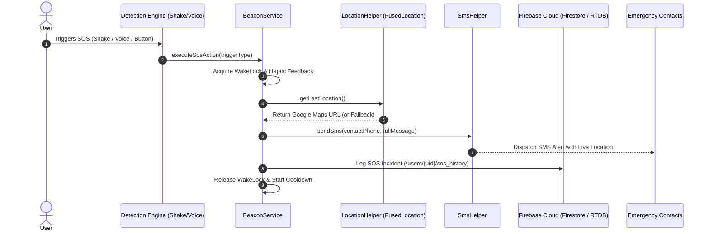
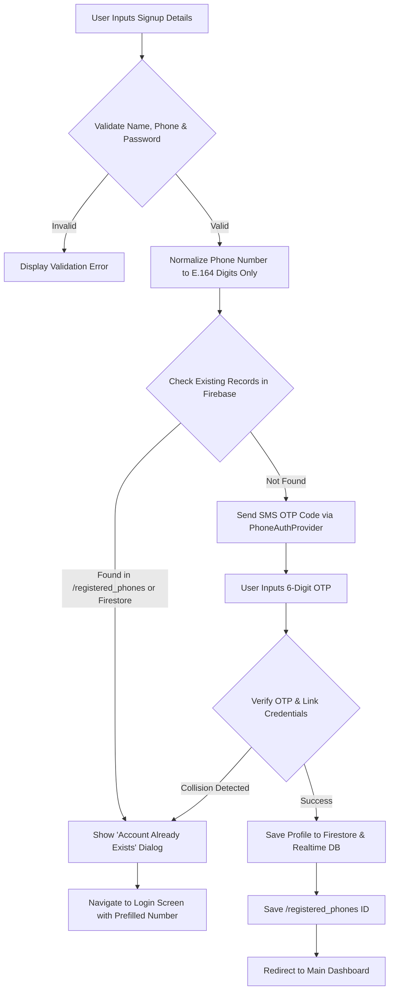

# Beacon SOS 🛡️
### *Enterprise-Grade Personal Safety & Rapid Emergency Response System for Android*

[](https://developer.android.com)
[](https://www.java.com)
[](https://firebase.google.com)
[](#-system-architecture)
[](https://m3.material.io)

---

## 📌 Executive Summary

**Beacon SOS** is an advanced, production-ready personal emergency response system engineered for Android. Built with a **resilient foreground service architecture**, Beacon SOS monitors for danger signals 24/7—even when the device is locked or in deep sleep (Doze Mode). 

Upon detecting an emergency through **gesture (shake)**, **voice command**, **safety timer countdown**, or **manual trigger**, the app immediately extracts high-precision GPS coordinates and dispatches localized emergency SMS alerts to chosen contacts, while synchronizing incident logs to the cloud.

---

## 🏗️ System Architecture

Beacon SOS follows a robust, event-driven service architecture with decoupled background workers, cloud synchronization, and local persistence.

```mermaid
graph TD
    subgraph UI_Layer [UI Layer - Material Design 3]
        MA[MainActivity / Navigation]
        HF[HomeFragment / SOS Button]
        CF[SosHistoryFragment]
        TC[TrustedContactsActivity]
        AC[AlertMessageActivity]
        LA[LoginActivity & SignupActivity]
    end

    subgraph Service_Layer [Background Service & Detection Engines]
        BS[BeaconService - Foreground Service]
        SD[ShakeDetector - Accelerometer]
        AD[AudioDetector - Low-Power Mic & Speech]
        LH[LocationHelper - Fused Location Provider]
        SH[SmsHelper - Telephony Manager]
    end

    subgraph Data_Layer [Data & Cloud Persistence Layer]
        TM[TriggerManager - Local SharedPreferences]
        FA[Firebase Authentication - OTP & Credentials]
        FR[Firebase Realtime Database - Live Presence & Nodes]
        FS[Cloud Firestore - Profile, Contacts, SOS Logs & Config]
    end

    %% Interactions
    LA -->|Authenticate / Pre-Check| FA
    MA -->|Monitor Session| FR
    HF -->|Trigger Manual SOS| BS
    BS -->|Gesture| SD
    BS -->|Voice| AD
    BS -->|GPS Coordinates| LH
    BS -->|Send SMS| SH
    BS -->|Sync Event| FS
    BS -->|Sync Event| FR
    AC -->|Save Configuration| FS
    TC -->|Sync Contacts| FS
    TM <-->|Local Cache| BS
```



---

## 🔄 Emergency SOS Trigger & Response Flow

The sequence diagram below illustrates the end-to-end execution flow when an emergency signal (Gesture/Voice/Manual) is detected by `BeaconService`.



---

## 🔐 Smart Identity & Registration Workflow

To protect against duplicate accounts and unnecessary SMS OTP consumption, Beacon SOS implements normalized E.164 pre-lookup before requesting phone verification.



---

## ✨ Key Enterprise Features

### ⚡ 1. Multi-Modal Emergency Triggers
* **Gesture-Based Shake Trigger**: Uses high-frequency accelerometer analysis to detect double/triple emergency shakes (`SHAKE_THRESHOLD_GRAVITY = 2.7G`).
* **Voice-Activated Trigger**: Continuous, low-power ambient audio monitoring that switches to `SpeechRecognizer` upon detecting acoustic energy spikes to recognize custom voice trigger phrases (e.g., *"Help Help"*).
* **Safety Check-in Countdown Timer**: Users can configure a countdown timer when entering unsafe zones. If not checked-in before expiration, the app automatically dispatches emergency alerts.
* **One-Tap Manual SOS**: High-visibility central SOS trigger with haptic feedback.

### 🛡️ 2. Smart Registration & Anti-Duplication Engine
* **Pre-SMS Lookup**: Checks normalized E.164 phone records in Firebase before requesting an SMS OTP, saving SMS quota.
* **Flexible Phone Formatting**: Accepts input with or without spaces, country codes, or dashes (`0321 123 4567`, `+923211234567`, `0321-1234567`) seamlessly.
* **Auto-Prefill Redirection**: Automatically transfers existing users to the Login screen with their number prefilled.

### ☁️ 3. Long-Term Cloud Data Persistence
* **Instant Cloud Sync**: All **Profile Avatars**, **Trusted Contacts**, **SOS Incident Logs**, and **SOS Configurations** (Custom Message, Voice Phrase, Recipients) are synced to Cloud Firestore and Realtime Database.
* **Multi-Month Data Retention**: Even if a user logs out for months or switches phones, logging back in instantly restores their entire configuration and emergency contact list.

### 🔄 4. Realtime Session Revocation & Auto-Logout
* **Active Token Listener**: Listens to Firebase Authentication state changes and Realtime Database node changes.
* **Instant Remote Logout**: If an admin deletes a user account from the Firebase Console, the mobile app detects the revocation within milliseconds, clears local cache, and safely returns to the Login screen.

### 🎨 5. Adaptive Modern UI / UX
* **Material Design 3 & Glassmorphism**: Clean layouts with elevated card views, custom loading animations, and glassy dialogs.
* **Dynamic Status Bar Contrast**: Automatically toggles light/dark status bar text contrast (`WindowInsetsControllerCompat`) based on active themes to guarantee readable time and battery icons.
* **Multi-Language Support (i18n)**: Fully internationalized in **7 languages**: English, Urdu, Spanish, Russian, Chinese, Japanese, and Arabic.

---

## 🛠️ Technology Stack & Libraries

| Domain | Technology / Library | Usage |
| :--- | :--- | :--- |
| **Language** | Java 17 | Core application codebase |
| **Architecture** | Service-Driven Clean Architecture | Decoupled background service & UI |
| **UI Framework** | Material Design 3, ConstraintLayout, ViewPager2 | UI components & glassmorphic layouts |
| **Backend & Auth** | Firebase BOM 33.1.2 | Auth (Phone & Email Link), Realtime DB, Firestore |
| **Location** | Google Play Services (Fused Location Provider) | High-accuracy GPS location extraction |
| **Maps** | OSMDroid 6.1.18 | OpenStreetMap integration & custom map overlays |
| **Country Picker** | CountryCodePicker (CCP) 2.7.3 | International phone formatting |
| **Image Loading** | Glide 4.x & CanHub Cropper | Profile photo cropping & circular caching |
| **Serialization** | Google Gson 2.10.1 | Local state serialization |

---

## ⚙️ Security & Resilience Highlights

* **Android 14+ Foreground Service Compliance**: Configured with `FOREGROUND_SERVICE_TYPE_MICROPHONE` and `LOCATION` with API level guards.
* **Doze Mode Persistence**: Employs partial CPU `WakeLock` management during active SOS dispatch to prevent OS battery optimization from killing SMS/GPS requests.
* **Memory Leak & Window Guards**: Enforces `isFinishing()` / `isDestroyed()` guards on all dialogs and unbinds receivers/listeners on service destroy.
* **Fail-Safe Location Callbacks**: Guarantees callback execution even if GPS permissions are denied or location fixes time out.

---

## 🚀 Installation & Local Setup

### Prerequisites
* **Android Studio**: Jellyfish / Koala or newer.
* **JDK**: Java 17.
* **Minimum SDK**: API 24 (Android 7.0 Nougat).
* **Target SDK**: API 34 (Android 14).

### Steps
1. **Clone the Repository**:
   ```bash
   git clone https://github.com/MuhammadQasim17/BeaconSOS_Final.git
   cd BeaconSOS_Final
   ```
2. **Firebase Configuration**:
   * Create a project in [Firebase Console](https://console.firebase.google.com/).
   * Enable **Phone Authentication** and **Email/Password Authentication**.
   * Enable **Realtime Database** and **Cloud Firestore**.
   * Download `google-services.json` and place it inside the `app/` directory.

3. **Build & Run**:
   * Open the project in Android Studio.
   * Sync Gradle files (`Sync Project with Gradle Files`).
   * Run on an Android device or Emulator (`Run 'app'`).

---

## 📄 License & Maintainer

Distributed under the MIT License. See `LICENSE` for details.

Developed & Maintained by **Muhammad Qasim**  
* **GitHub**: [@MuhammadQasim17](https://github.com/MuhammadQasim17)  
* **Project**: Beacon SOS Application  

---

> **Beacon SOS - Your Safety, Our Priority 🛡️**
